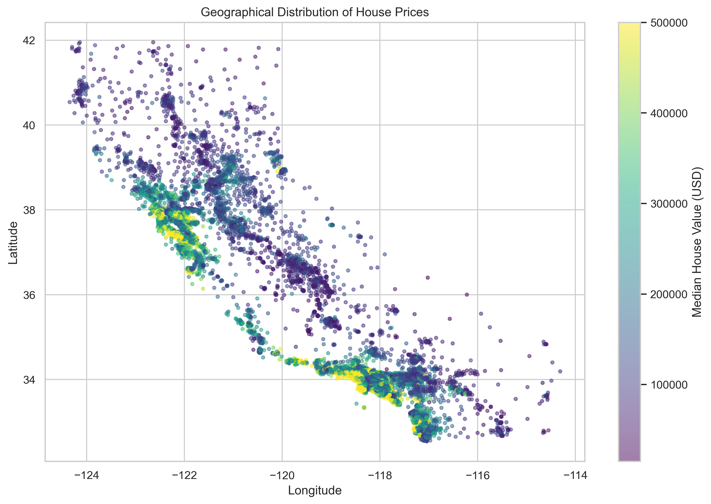
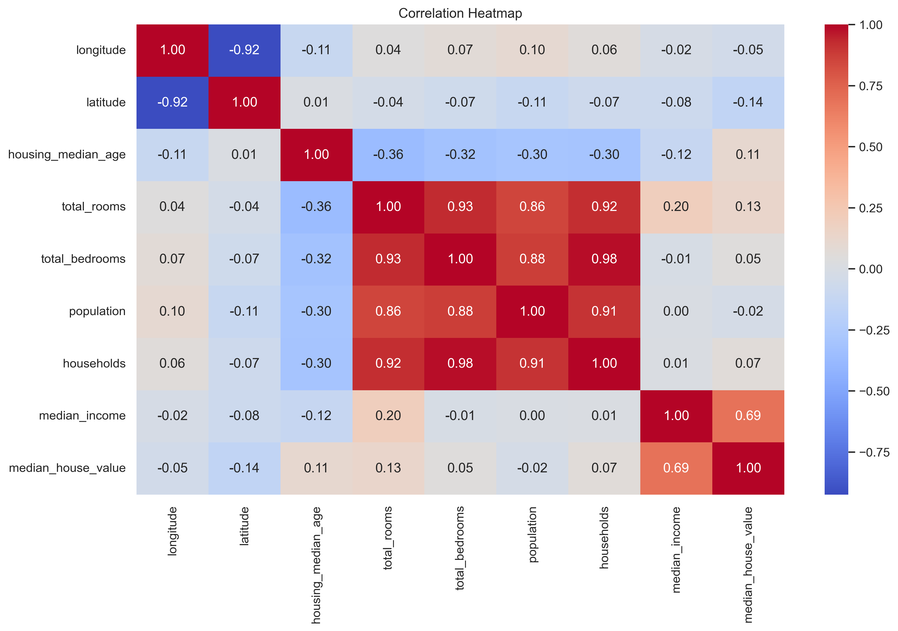
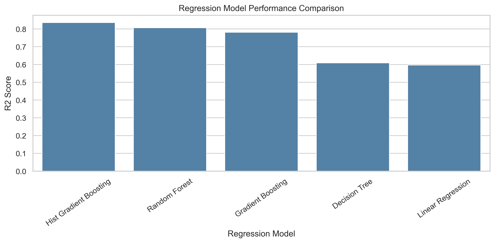
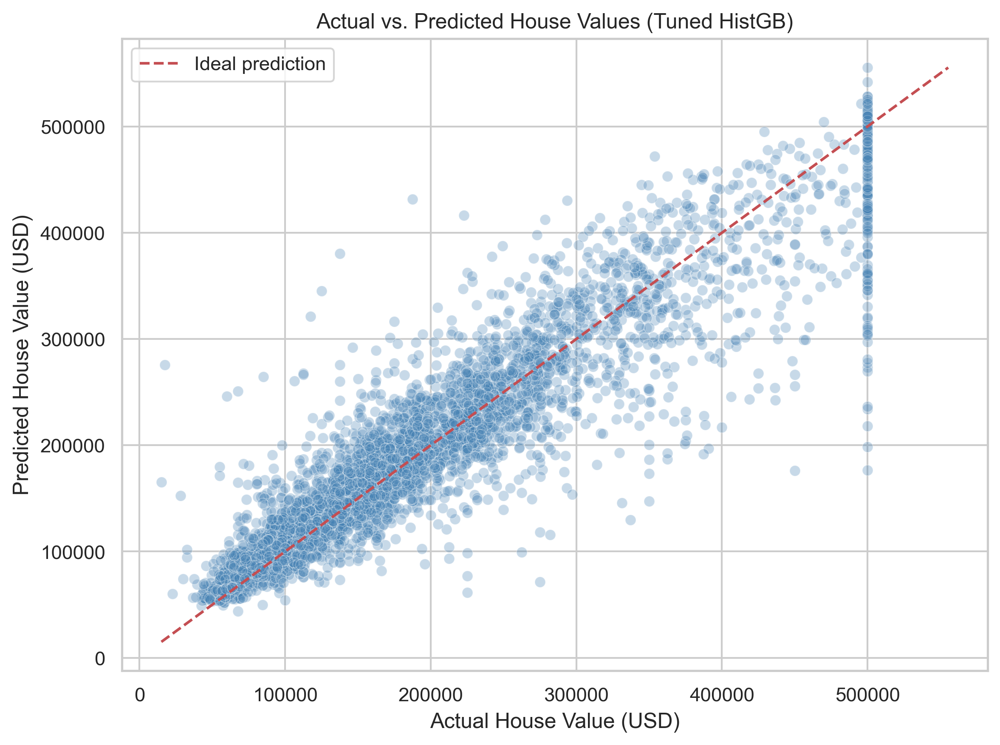
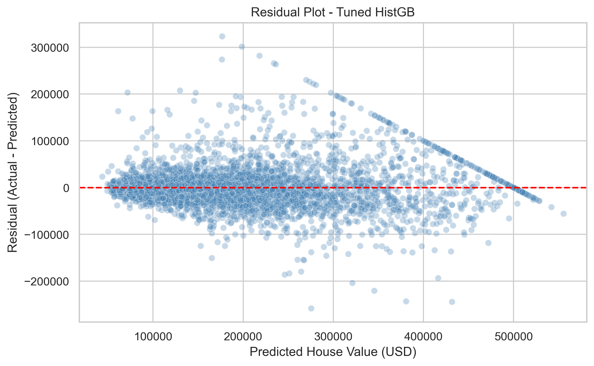
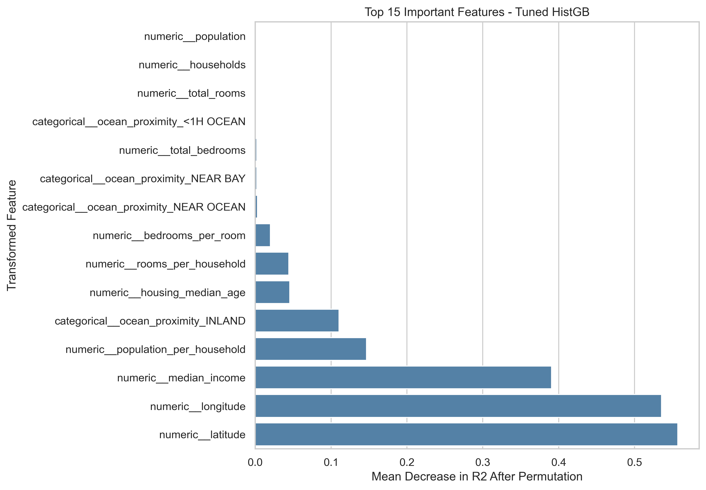

# California Housing Price Prediction

[](https://www.python.org/)
[](https://jupyter.org/)
[](https://scikit-learn.org/)

An end-to-end **supervised machine-learning regression project** that predicts district-level median house values in California from 1990 Census-era housing data. The workflow covers data inspection, exploratory analysis, feature engineering, preprocessing pipelines, model comparison, hyperparameter tuning, evaluation, interpretation, and model export.

> **Scope:** The target is the historical district-level `median_house_value` in the supplied dataset. This is an educational portfolio project—not a current property valuation service or a guarantee of an individual home's sale price.

## Project at a glance

| Item | Details |
|---|---|
| Problem type | Supervised regression |
| Dataset | California Housing (modified teaching version) |
| Observations | 20,640 |
| Input columns | 9 |
| Target | `median_house_value` |
| Models compared | 5 regression algorithms |
| Best saved model | Tuned `HistGradientBoostingRegressor` |
| Test R² | **0.8424** |
| Test RMSE | **$45,441.13** |
| Test MAE | **$30,100.08** |
| Charts | 14 high-resolution PNG visualizations |

## Key features

- Exploratory data analysis covering distributions, correlations, geography, and ocean-proximity categories.
- Data-quality checks for missing values, duplicates, data types, and summary statistics.
- Three engineered household-level ratio features.
- Preprocessing and feature engineering inside scikit-learn pipelines to reduce data leakage.
- Comparison of five regression algorithms on a held-out test set.
- `RandomizedSearchCV` tuning with 30 candidates and 5-fold cross-validation.
- Evaluation using MAE, MSE, RMSE, and R².
- Permutation feature importance and actual-versus-predicted/residual analysis.
- Exported fitted pipeline, predictions, metrics, and 14 visualizations.

## Visual project gallery

The charts below are generated by the project notebook and stored in `visualizations/`.

### Exploratory data analysis

**California housing value geography**



**Feature correlation**



### Model evaluation

**Baseline model comparison**



**Tuned model: actual vs. predicted**



**Tuned model residual analysis**



**Permutation feature importance**



[View all 14 charts in the visualizations folder](visualizations/).

## Dataset and attribution

The supplied `Dataset/housing.csv` contains **20,640 rows and 10 columns**, including 207 missing values in `total_bedrooms`. Its schema and missing-value pattern match the modified California Housing teaching dataset documented in Aurélien Géron's *Hands-On Machine Learning* repository.

- **Modified teaching dataset documentation:** [ageron/handson-ml — California Housing README](https://github.com/ageron/handson-ml/blob/master/datasets/housing/README.md)
- **Dataset file in that repository:** [housing.csv](https://github.com/ageron/handson-ml/blob/master/datasets/housing/housing.csv)
- **Original dataset background:** [scikit-learn — California Housing dataset](https://scikit-learn.org/stable/datasets/real_world.html#california-housing-dataset)

The modified teaching version is described as a version of the California Housing data obtained through Luís Torgo's University of Porto page and the StatLib repository. It is based on 1990 California Census block-group data. The teaching version removes 207 values from `total_bedrooms` and adds the `ocean_proximity` categorical column.

**Original research reference**

Pace, R. Kelley, and Ronald Barry. “Sparse Spatial Autoregressions.” *Statistics & Probability Letters*, 33 (1997), 291–297.

**Data-use note:** Dataset attribution is provided for transparency. Before redistributing the CSV in a public repository, check the source repository and dataset terms and retain any required notices. This project does not claim ownership of the underlying data.

### Dataset fields

| Column | Description |
|---|---|
| `longitude`, `latitude` | Geographic location of the census block group |
| `housing_median_age` | Median house age |
| `total_rooms` | Total rooms in the block group |
| `total_bedrooms` | Total bedrooms; 207 values are missing |
| `population` | Population of the block group |
| `households` | Number of households |
| `median_income` | Median income |
| `ocean_proximity` | Categorical proximity-to-ocean group |
| `median_house_value` | **Prediction target** |

## Methodology

1. **Load and inspect data:** review dimensions, data types, descriptive statistics, missing values, duplicates, and category counts.
2. **Explore the data:** create distribution plots, a correlation heatmap, income/value comparisons, category comparisons, boxplots, and a geographic plot.
3. **Split the data:** use an 80:20 train-test split with `random_state=42`.
4. **Engineer features:** add:
   - `rooms_per_household`
   - `bedrooms_per_room`
   - `population_per_household`
5. **Preprocess within pipelines:** impute missing numeric values, standardize numeric features, and one-hot encode `ocean_proximity`.
6. **Compare baseline models:** train five regression algorithms.
7. **Tune the leading model family:** use 30 randomized candidates, 5-fold cross-validation, R² scoring, and `random_state=42` for `HistGradientBoostingRegressor`.
8. **Evaluate and interpret:** calculate regression metrics, inspect residuals, and calculate permutation feature importance.
9. **Export:** save the fitted pipeline and supporting outputs.

### Models compared

- Linear Regression
- Decision Tree Regressor
- Random Forest Regressor
- Gradient Boosting Regressor
- HistGradientBoostingRegressor (baseline and tuned)

### Leakage prevention

The feature engineer, imputer, scaler, and categorical encoder are part of the scikit-learn pipeline. They are fitted on training data only; during cross-validation, each fold learns its own preprocessing parameters. The held-out test set is reserved for final evaluation.

## Model performance

The table below is calculated from the saved comparison CSV and tuned-model prediction CSV in `models/`.

| Model | MAE | RMSE | R² |
|---|---:|---:|---:|
| Linear Regression | 50,898.74 | 72,701.33 | 0.596654 |
| Decision Tree | 43,803.51 | 71,558.26 | 0.609238 |
| Random Forest | 32,325.26 | 50,324.73 | 0.806734 |
| Gradient Boosting | 36,493.67 | 53,511.82 | 0.781479 |
| Hist Gradient Boosting (baseline) | 30,841.83 | 46,378.34 | 0.835857 |
| **Hist Gradient Boosting (tuned)** | **30,100.08** | **45,441.13** | **0.842424** |

### Saved tuned-model metrics

| Metric | Value |
|---|---:|
| Mean Absolute Error (MAE) | $30,100.08 |
| Mean Squared Error (MSE) | 2,064,896,520.00 |
| Root Mean Squared Error (RMSE) | $45,441.13 |
| R² score | 0.842424 |
| Best cross-validation R² | 0.841543 |

### Selected hyperparameters

```text
model__max_leaf_nodes: 31
model__max_iter: 200
model__max_depth: 10
model__learning_rate: 0.1
model__l2_regularization: 1
```

The tuned model improves the saved baseline HistGradientBoosting test R² from **0.835857** to **0.842424**. These results describe this dataset and this particular split; they do not establish performance on present-day housing transactions.

## Quick start

### 1. Clone the repository

Replace `YOUR-USERNAME` with your GitHub username:

```bash
git clone https://github.com/YOUR-USERNAME/california-housing-price-prediction.git
cd california-housing-price-prediction
```

### 2. Create and activate a virtual environment

**Windows PowerShell**

```powershell
python -m venv .venv
.\.venv\Scripts\Activate.ps1
python -m pip install --upgrade pip
pip install -r requirements.txt
```

**macOS / Linux**

```bash
python3 -m venv .venv
source .venv/bin/activate
python -m pip install --upgrade pip
pip install -r requirements.txt
```

### 3. Launch the notebook

From the project root:

```bash
jupyter notebook notebooks/Final_Project_Notebook.ipynb
```

Open the notebook and select **Run All** to reproduce the analysis. Running from the project root is recommended because the notebook expects the `Dataset/`, `models/`, `src/`, and `visualizations/` project folders.

## Sample prediction

The saved model is a complete scikit-learn pipeline. It accepts the original, unencoded input columns, including the `ocean_proximity` category.

Run this example from the project root:

```python
from pathlib import Path

import joblib
import pandas as pd

model_path = Path("models/Housing_Price_Prediction_System.pkl")
model = joblib.load(model_path)

sample_house = pd.DataFrame([{
    "longitude": -119.01,
    "latitude": 36.06,
    "housing_median_age": 25.0,
    "total_rooms": 1505.0,
    "total_bedrooms": float("nan"),
    "population": 1392.0,
    "households": 359.0,
    "median_income": 1.6812,
    "ocean_proximity": "INLAND",
}])

predicted_value = model.predict(sample_house)[0]
print(f"Predicted median house value: ${predicted_value:,.2f}")
```

**Saved test-set example:** for the sample above, the saved prediction output reports a predicted value of **$62,279.65**, compared with an actual value of **$47,700.00** (absolute error: **$14,579.65**).

The model uses the custom `HousingFeatureEngineer` transformer in `src/housing_features.py`. Keep the `src/` package in the project root when loading the serialized pipeline.

> **Model-loading safety and compatibility:** Only load the `.pkl` file if you trust its source. Pickle-based files can execute code when loaded. The saved metadata records scikit-learn `1.9.0`; use a compatible environment when loading the model. If compatibility problems occur, install the project's dependencies and retrain by running the notebook.

## Repository structure

```text
Housing_Price_ML_Project/
├── Dataset/
│   └── housing.csv
├── models/
│   ├── Housing_Price_Prediction_System.pkl
│   ├── baseline_model_comparison.csv
│   ├── hist_gradient_boosting_comparison.csv
│   ├── model_metadata.json
│   ├── permutation_feature_importance.csv
│   └── tuned_model_test_predictions.csv
├── notebooks/
│   └── Final_Project_Notebook.ipynb
├── src/
│   ├── __init__.py
│   └── housing_features.py
├── visualizations/
│   └── 14 PNG charts
├── scripts/
│   └── verify_artifacts.py
├── execution_log.txt
├── verification_report.json
├── .gitignore
├── README.md
└── requirements.txt
```

## Output files

| File | Purpose |
|---|---|
| `models/Housing_Price_Prediction_System.pkl` | Exported fitted prediction pipeline |
| `models/model_metadata.json` | Dataset hash, split settings, selected parameters, metrics, and library version |
| `models/baseline_model_comparison.csv` | Baseline model comparison metrics |
| `models/hist_gradient_boosting_comparison.csv` | Baseline versus tuned HistGradientBoosting results |
| `models/tuned_model_test_predictions.csv` | Actual values, predictions, and absolute errors |
| `models/permutation_feature_importance.csv` | Permutation feature importance |
| `visualizations/` | 14 PNG charts saved at 300 DPI |
| `execution_log.txt` | Notebook code-cell execution log |
| `verification_report.json` | Notebook execution and artifact verification record |

## Verify the saved model artifacts

After installing the dependencies, run this command from the project root:

```bash
python scripts/verify_artifacts.py
```

The verification script checks the dataset SHA-256 hash, loads the saved pipeline, recreates the deterministic train-test split, recalculates MAE/MSE/RMSE/R², and confirms that the exported prediction CSV matches the model's predictions.

### Audit status

The saved model was independently loaded in a fresh Python process and its predictions reproduced the metrics in `model_metadata.json` and `tuned_model_test_predictions.csv`. The dataset hash, notebook schema, sample prediction, and 14 chart files were also checked. The current `verification_report.json` records these artifact-level checks.

**Version compatibility:** the model metadata records scikit-learn `1.9.0`. The audit runtime used scikit-learn `1.8.0`; the model loaded and reproduced the saved results, but emitted scikit-learn `InconsistentVersionWarning` warnings. The `requirements.txt` therefore pins scikit-learn to `1.9.0`. Use that version when loading the serialized model to avoid cross-version compatibility warnings.

**Notebook rerun:** the complete notebook was not rerun during this artifact audit. The original cell execution log is retained and explicitly labelled historical. After installing the pinned dependencies, run every notebook cell from top to bottom to regenerate the model, metadata, predictions, charts, and execution log together. The audit report does not claim a fresh full-notebook execution.

## Limitations

- The data comes from the 1990 California Census and is not a current housing-market dataset.
- The model predicts a district-level median value, not the price of an individual property.
- The model may not generalize to other regions, time periods, or market conditions.
- The target values and dataset design impose limitations on how predictions should be interpreted.
- The model is intended for education and experimentation, not financial, legal, lending, or real-estate decisions.

## Future improvements

Potential next steps for extending this project:

1. **Reproducible release:** rerun the full notebook and regenerate every model and verification artifact in one consistent environment.
2. **Stronger validation:** add repeated cross-validation and a geographic or spatially aware validation strategy to test generalization across locations.
3. **Model expansion:** evaluate additional algorithms such as Extra Trees, HistGradientBoosting alternatives, and carefully tuned gradient-boosting libraries.
4. **Interpretability:** add SHAP explanations and individual prediction explanations alongside permutation importance.
5. **Prediction uncertainty:** investigate prediction intervals or conformal prediction rather than reporting only a single point estimate.
6. **Interactive demo:** build a Streamlit or FastAPI interface for entering housing attributes and viewing predictions.
7. **Automated quality checks:** add unit tests for feature engineering, input validation, and prediction behavior, plus GitHub Actions for continuous integration.
8. **Data freshness and monitoring:** if a properly licensed, more recent dataset becomes available, retrain and evaluate the model against a time-relevant benchmark.

## Dependencies

Install dependencies with:

```bash
pip install -r requirements.txt
```

The project uses NumPy, pandas, Matplotlib, Seaborn, scikit-learn, joblib, Jupyter, and IPython Kernel.

## License

No license file is currently included. Add a project license only after confirming the rights to license the project code and redistribute the dataset. The dataset's original attribution and any applicable terms should be retained.
